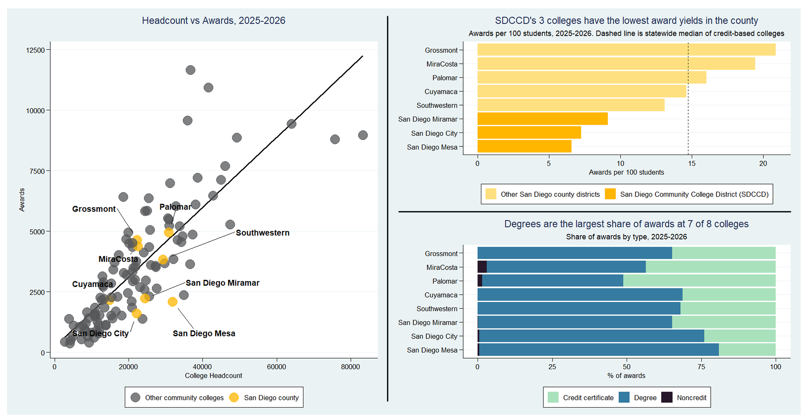

# Award Yield and Award Mix: San Diego County Community Colleges, 2025-2026
Cross-sectional analysis of award yield (per 100 students enrolled) and award mix metrices
for San Diego county community colleges for the 2025-2026 academic year.
Data source was the California Community Colleges Chancellor's Office Data Mart.

**Files:** `CCCCO_Analysis_Script.R` (analysis), `San Diego County Colleges Award Yield Report.Rmd` (report), `ProgAwards.csv` and `StudentHeadcounts.csv` (raw data files).
