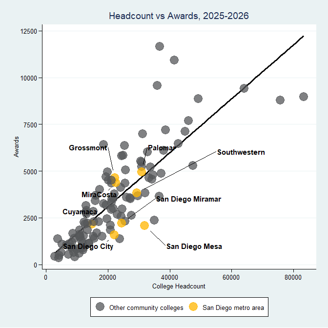
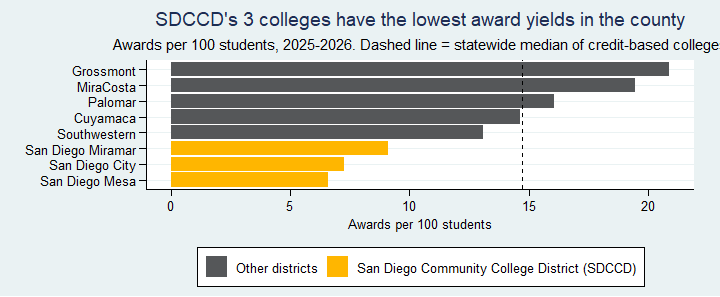
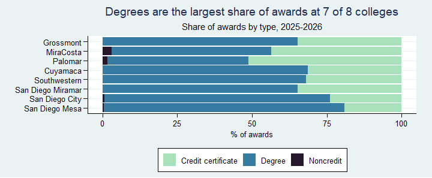

Award Yield and Award Mix: San Diego County Community Colleges,
2025-2026
================
Teresa McCarrell \*
November 07, 2026

## Key Takeaways

Among the 8 credit-based community colleges in San Diego County, award
yield ranges from 6.6 to 20.9 awards per 100 students. The median for
the county is 13.9, which is not significantly different. There is wide
variation within the county, ranging from 6.5 at San Diego Mesa to 20.9
at Grossmont. The three San Diego Community College District (SDCCD)
colleges have the lowest yields for the county. The three SDCCD colleges
have a median yield of 7.3 awards per 100 students, compared with 16.0
for the other five county colleges.

## Introduction and Methodology

- **Data Source:** CCC Chancellor’s Office MIS Data Mart, Program Awards
  and Annual/Term Student Count reports, downloaded 11/05/2026.
- **Year Choice:** The most recent available year, 2025-2026 ,had a
  statewide award total (436,895) that was higher than the value for
  2024-2025, indicating that the data for 2025-2026 was likely complete.
- **Comparison Group:** All 8 credit colleges in San Diego County were
  included. The San Diego College of Continuing Education was excluded
  because all of its awards are noncredit.
- **Data Checks:** Data was reshaped prior to analysis; college names
  were reconciled across both files, and two names were standardized;
  award types summed to each college’s total for every college and year;
  award shares verified to have summed to 100%.

Figure 1: The headcounts for each college in the dataset were plotted
against the number of awards. San Diego area colleges are highlighted in
gold to establish their positioning in terms of enrollment and awards
among the instititional pool.

The following two metrics were used in this report.

| Metric | Definition |
|----|----|
| **Award yield** | Degrees and certificates awarded per 100 students enrolled (annual headcount). This is a same-year ratio, not a cohort completion rate. |
| **Award mix** | The proportion of a college’s awards that are degrees, credit certificates, or noncredit awards. |

## Findings

Colleges in both figures are ordered by award yield, highest at the top.

Figure 2. The three SDCCD colleges are all below 9.1 awards per 100
students; the other five are all above 13.1. The dashed line represents
the median yield, which is 14.7. San Diego county’s 8 colleges are not
significantly different from the median - however, the cluster of three
SDCCD colleges are.

Figure 3. Degrees are the largest share of awards at 7 of 8 colleges.
Palomar is the exception, with credit certificates pulling slightly
ahead, at 51% of awards, where degrees are 47% of awards. Mira Costa and
Palomar hold the highest proportion of noncredit awards. San Diego Mesa
and San Diego City hold the highest proportion of degrees, at 80% and
75% of their awards, respectively.

## Limitations and Next steps

- Award yield is a same-year ratio, not a cohort completion rate. The
  inclusion of additional years might offset biases caused by differing
  enrollment rates year-to-year.
- Awards are counted, not students, so one student earning several
  awards counts several times.
- Equity gaps were not examined; the Data Mart awards report selector
  tool had no race/ethnicity breakdown.
- *Suggested next steps:* Investigate the reasons behind SDCCD’s gap in
  award yield compared to the rest of the county and the state median;
  this may be due in part to the relationship between having a higher
  share of degrees awarded vs a lower ‘award yield’ as a degree takes
  longer to complete in comparison to a credit certificate or non-credit
  award. Therefore, the cross-sectional analysis approach introduces
  bias against colleges which have a higher share of awards that take
  longer to achieve.
